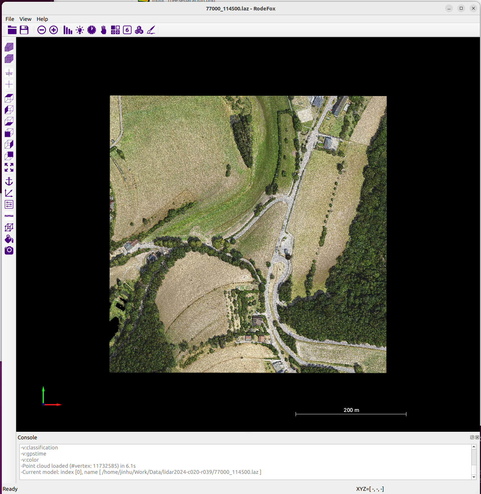
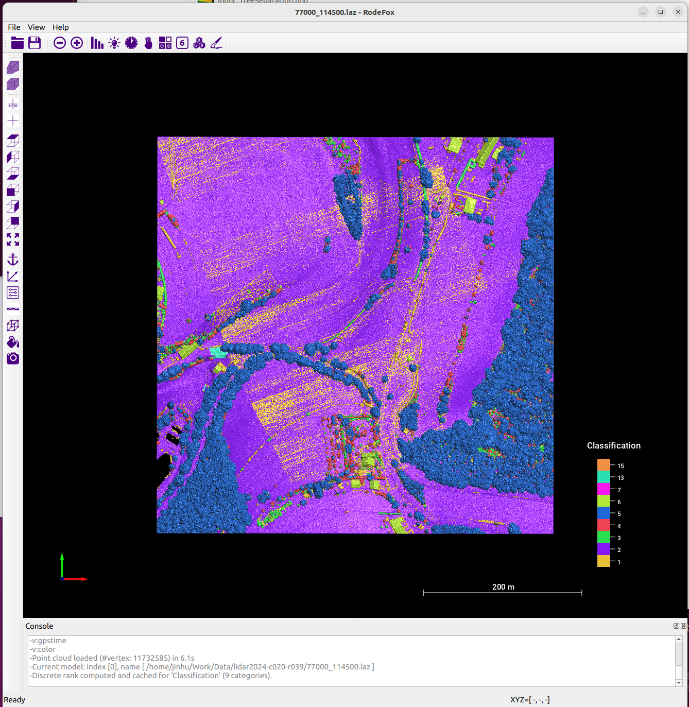
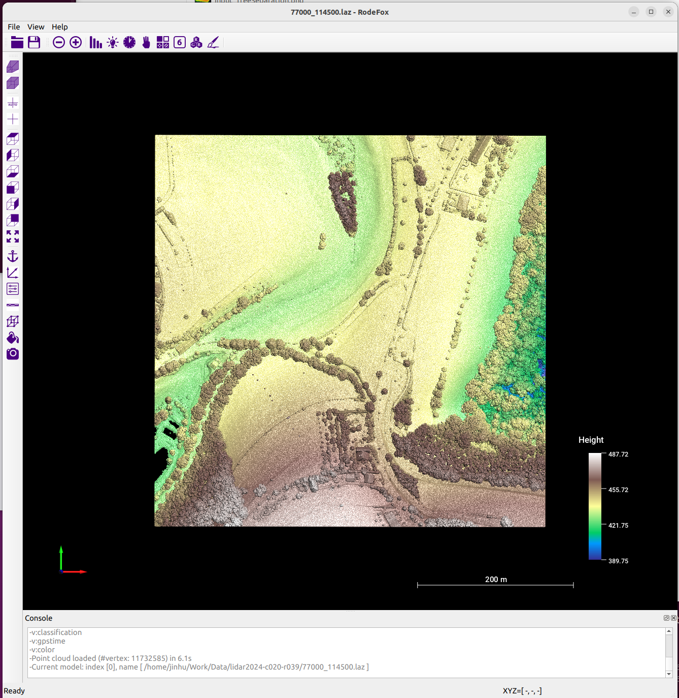
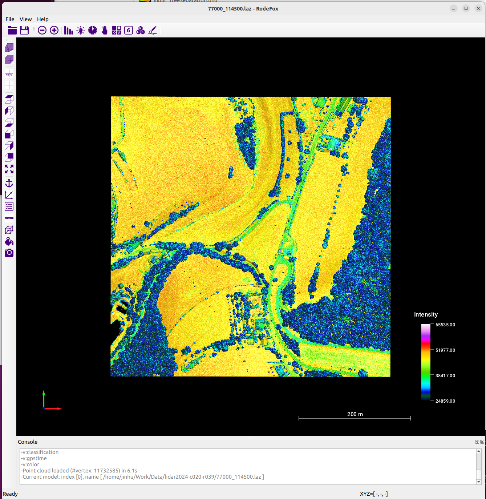

# RodeFox

**RodeFox** is a desktop application for visualizing and processing 3D LiDAR point cloud data.

It loads large airborne/terrestrial LiDAR tiles (e.g. `.laz`) and lets you inspect them interactively, switching between different per-point attributes for coloring, with a legend, a metric scale bar and a built-in console that logs what the application is doing.

> Current version: **v0.1.1**

## Download

A pre-built installer for Windows (64-bit) is available here:

**[⬇️ Download RodeFox 0.1.1 for Windows (x64, .zip)](https://jinhu-wang.github.io/assets/software/RodeFox-0.1.1-win64.zip)**

### Installation

1. Download `RodeFox-0.1.1-win64.zip` from the link above.
2. Extract the archive to a folder of your choice.
3. Run the installer from the extracted folder and follow the on-screen instructions.

> Only Windows 64-bit builds are provided at the moment.

## Demo video

▶️ Click the image above to watch the RodeFox introduction on YouTube.

## Visualization

The screenshots below show the same LiDAR tile (~11.7 million points) rendered with four different coloring modes.

| RGB color | Classification |
| :---: | :---: |
|  |  |
| **Height (elevation)** | **Intensity** |
|  |  |

## Features (v0.1.1)

- **Point cloud I/O** – open and save LiDAR point clouds, including compressed LAS (`.laz`).
- **Scalar-field coloring** – color points by RGB, classification, height, intensity, and other stored per-point attributes (e.g. GPS time).
- **Discrete & continuous legends** – automatic categorical legend for classification codes and color ramps for continuous attributes.
- **Interactive 3D navigation** – standard views (top, bottom, front, back, left, right), fit-to-screen, adjustable point size, and a navigation axis indicator.
- **Scale bar** – on-screen metric scale for quick distance reading.
- **Console** – logs loading statistics (point count, load time), available attributes, and processing steps.
- **Snapshot** – capture the current view as an image.

## License

RodeFox is released under the [GNU General Public License v3.0](LICENSE).
